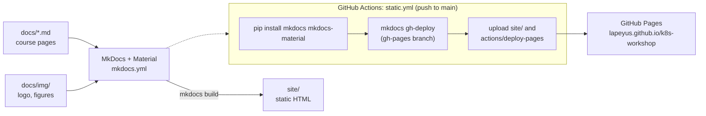

# Opinionated GKE CD Workshop

Source for a hands-on workshop site on continuous deployment to Google Kubernetes Engine (GKE) with
Helm, Argo CD, Artifact Registry and Terraform, built with MkDocs Material and published to GitHub
Pages.

**Live site:** <https://lapeyus.github.io/k8s-workshop/>

## Description

The workshop is planned as a 5 to 6 hour guided session for engineers who know the basics of
Kubernetes, Helm and Terraform and want to see a full GitOps delivery path on Google Cloud: create a
GKE cluster, package an app with Helm, deploy it continuously with Argo CD, store images in
Artifact Registry and manage the infrastructure with Terraform templates.

This repository holds only the course content (Markdown pages) and the site configuration. It does
not contain application code, Helm charts or Terraform modules.

## Features

- Thirteen-page course outline, from prerequisites to clean-up and Q&A (see
  [Content status](#content-status)).
- Step-by-step setup of a GCP account with least-privilege IAM roles for GKE.
- Installation guides for the Google Cloud SDK, `kubectl` and Helm.
- Commands to create a GKE cluster and install Argo CD from its Helm chart.
- Material theme with light, dark and automatic color schemes, site search and admonitions.
- Automatic deployment to GitHub Pages on every push to `main`.

## Architecture



## Requirements

- Python 3.8 or newer.
- `mkdocs` and `mkdocs-material` (unpinned in CI).
- Optional: [pre-commit](https://pre-commit.com/) if you want to run the configured hooks.

## Quick start

```bash
git clone https://github.com/Lapeyus/k8s-workshop.git
cd k8s-workshop

python3 -m venv .venv
source .venv/bin/activate
pip install mkdocs mkdocs-material

mkdocs serve        # live preview at http://127.0.0.1:8000
```

Or, without a virtual environment, using [uv](https://docs.astral.sh/uv/):

```bash
uvx --with mkdocs-material mkdocs serve
```

## Usage

- **Edit a page:** change the matching file in `docs/`; `mkdocs serve` reloads the browser.
- **Add a page:** create `docs/<name>.md` and add it to the `nav` list in `mkdocs.yml`.
- **Build the static site:** `mkdocs build` writes to `site/`.
- **Publish:** push to `main` (see [Deployment](#deployment)).

### Content status

| Page | File | Status |
|---|---|---|
| Home | `docs/index.md` | written (overview and table of contents) |
| Prerequisites | `docs/prerequisites.md` | short list of required knowledge |
| Introduction | `docs/introduction.md` | written (labs, duration, support) |
| Terraform Templates Creation | `docs/terraform-templates.md` | empty |
| Setting Up the Environment | `docs/environment-setup.md` | written (IAM, gcloud, kubectl, Helm, cluster) |
| Helm Charts Creation | `docs/helm-charts.md` | empty |
| Argo CD Setup and Configuration | `docs/argocd-setup.md` | partial (install via Helm; repo and app steps are placeholders) |
| Artifact Registry Integration | `docs/artifact-registry.md` | empty |
| Deploying the Full Stack | `docs/full-stack-deployment.md` | empty |
| Clean Up | `docs/clean-up.md` | empty |
| Q&A Session | `docs/qa-session.md` | empty |
| Conclusion and Additional Resources | `docs/conclusion.md` | empty |
| Support | `docs/support.md` | empty |

## Repository structure

```text
.
├── docs/                     # course content (MkDocs source)
│   ├── index.md              # home page
│   ├── introduction.md
│   ├── prerequisites.md
│   ├── environment-setup.md
│   ├── argocd-setup.md
│   ├── terraform-templates.md, helm-charts.md, artifact-registry.md,
│   │   full-stack-deployment.md, clean-up.md, qa-session.md,
│   │   conclusion.md, support.md   # placeholders
│   ├── blog/index.md         # stub, not in the nav
│   └── img/                  # logo, favicon, figures
├── site/                     # generated HTML (committed build output)
├── mkdocs.yml                # site name, nav, Material theme, extensions
├── .pre-commit-config.yaml   # formatting and lint hooks
└── .github/workflows/
    └── static.yml            # build and deploy to GitHub Pages
```

## Configuration

- `mkdocs.yml`: site metadata, navigation order, theme (Material, Roboto, palette toggle), plugins
  (`search`) and Markdown extensions (`admonition`, `codehilite`, `pymdownx.betterem`).
- `.github/workflows/static.yml` uses a repository secret named `PERSONAL_ACCESS_TOKEN` for the
  Pages deployment step, plus the default `GITHUB_TOKEN` for `mkdocs gh-deploy`.
- No local secret files are needed. There is no `.gitignore`, so `site/` and `.DS_Store` files end
  up committed.

## Tests

There are no automated tests. A strict build passes:

```bash
mkdocs build --strict
```

(Last run October 2026 with current `mkdocs` and `mkdocs-material`: success; it only notes that
`blog/index.md` is not in the nav.)

`.pre-commit-config.yaml` declares many hooks (Prettier, yamllint, markdownlint, link checks and
several Python tools copied from a template), but some reference files that do not exist here
(for example `.yamllint.yaml`, `src/`), so `pre-commit run --all-files` is not expected to pass as is.

## Deployment

`.github/workflows/static.yml` runs on every push to `main` and on manual dispatch. It installs
MkDocs and Material, runs `mkdocs gh-deploy --force --clean` (which also pushes the built site to a
`gh-pages` branch), then uploads `site/` as a Pages artifact and deploys it with
`actions/deploy-pages`.

## Project status

**Draft, inactive.** All five commits are from 25 August 2023. The site is live, but most chapters
are empty placeholders and the Argo CD chapter ends with placeholder comments.

### Known limitations

- Most course chapters have no content yet (see the table above).
- The table of contents in `docs/index.md` lists chapters in a different order than the site nav.
- `mkdocs.yml` still has a template value for `site_author`.
- Some pages include an example IAM command filled in with a specific project and account; replace
  those with your own values.
- The workflow uses older action versions (`actions/checkout@v3`, `setup-python@v2`,
  `upload-pages-artifact@v2`, `deploy-pages@v2`) that GitHub has deprecated.

## License

No license file is included, so default copyright applies.
